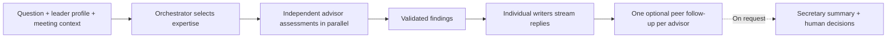

# Sim CEO

**A personal advisory board powered by Meta Muse: researched experts, independent judgment, and a conversation that turns ideas into next steps.**

Describe a problem, choose your advisors, and hold a meeting. Sim CEO brings their different expertise together, tailors the explanations to your background, and lets them challenge both your assumptions and each other.

## Run the demo

**Requirements:** Git, Docker with Compose v2, and a Meta Model API key with access to Muse Spark, Muse Image, and Muse Voice Transcribe. Docker builds the frontend and API; no local Node or .NET installation is required.

```sh
git clone https://github.com/Flacksacc/sim_ceo.git
cd sim_ceo
```

Copy `.env.example` to `.env` (`cp .env.example .env` on macOS/Linux, `Copy-Item .env.example .env` in PowerShell). Edit these values:

```dotenv
POSTGRES_PASSWORD=choose-a-database-password
META_API_KEY=your-meta-model-api-key
META_API_BASE=https://api.meta.ai/v1
APP_HOST_PORT=5173
```

Keep `.env` private. For an existing installation, keep its database password.

From the repository root:

```sh
docker compose --env-file .env --project-name simceo-essentials -f qa/essentials-backend/simceo-essentials.compose.yaml up -d --build
```

Open **[http://localhost:5173](http://localhost:5173)** after the containers are healthy. The first build downloads dependencies and can take several minutes. This is the current two-service demo stack: the app and PostgreSQL, with persistent database and app-data volumes.

| Check | Expected result |
| --- | --- |
| [Health](http://localhost:5173/health) | `ok: true` |
| [Readiness](http://localhost:5173/ready) | `ready: true`, `store: "postgres"` |

Stop the demo while keeping saved data:

```sh
docker compose --env-file .env --project-name simceo-essentials -f qa/essentials-backend/simceo-essentials.compose.yaml stop
```

Run the startup command again to restart. Windows users can use the [PowerShell helper](qa/essentials-backend/essentials-persist.ps1) for updates with automatic backups.

## Features

- **Personal context.** Your default profile tells advisors your background, existing knowledge, explanation needs, and communication preferences.
- **Researched advisors.** A name, description, and optional links become three editable character paragraphs and an automatically generated portrait. Inspect references, replace portraits, and test advisors in direct chat.
- **Focused boards.** Select up to ten advisors from your searchable roster. Profile edits carry through to subsequent board conversations.
- **Live meetings.** Separate briefs and histories, editable voice dictation, advisor activity indicators, streamed formatted replies, and pause/resume controls.
- **Document context.** Drop attachments into a meeting and inspect the source passages used for advice.
- **Secretary and records.** Request summaries, briefings, open questions, and next steps. Review proposed decisions before accepting them.

## The advisor engine

**Each advisor has a researched perspective, a reason to contribute, and a responsibility to make a defensible judgment.** The engine coordinates those perspectives while preserving their independence.

1. **Compile expertise.** Research produces three editable instructions: **when to contribute**, **how to reason**, and **how to respond**. These drive selection and every answer.
2. **Route intelligently.** The orchestrator selects relevant specialists from the meeting participants, respecting explicit requests for an advisor or a particular deliverable.
3. **Personalize the context.** Each advisor receives its own character, your profile, the brief, conversation history, and eligible evidence. Private board conversations stay separate from reusable characters.
4. **Assess independently, in parallel.** Each selected specialist evaluates strengths, concerns, missing information, and next steps before writing. Quoted passages are checked against supplied context; unsupported assessments block the writer.
5. **Stream a defensible answer.** Advisors can support, challenge, give a mixed judgment, or ask for context. They explain the reasoning at your level; communication preferences never require agreement.
6. **Make disagreement productive.** Each advisor can review peers' first replies and add one substantive follow-up. Peer challenges target actual statements; advisors can abstain when they have nothing useful to add.



Activity distinguishes considering from responding. Private reasoning stays private. Final publication checks access and context freshness; interrupted or stale previews are not saved as completed answers.

## Built with Meta models

| Model capability | Role in Sim CEO |
| --- | --- |
| **Muse Spark** | Advisor selection, character compilation, independent assessments, replies, and secretary assistance |
| **Meta web search grounding** | Research for advisor profiles, with source references for inspection |
| **Muse Image** | Automatic advisor portraits and user-requested replacements |
| **Muse Voice Transcribe** | Dictation into an editable message draft |

**Stack:** React/TypeScript, ASP.NET Core 10, SignalR, and PostgreSQL. Documents use local extraction and keyword retrieval over indexed passages.

## Hackathon focus

Built for the Meta Global AI Developer Hackathon's **Build for Your World** theme: specialist perspectives for decisions in your own domain. Technical ambition is demonstrated through parallel agents, independent assessment, bounded peer interaction, grounded research, and multimodal input in a persistent application. [Event themes and judging overview](https://cerebralvalley.ai/e/meta-ai-developer-hackathon).

**A quick demonstration:** save your profile, research an advisor, choose a board, drop in a short brief, and ask for a recommendation. Watch relevant experts respond, question an assumption, and review a peer's advice. Ask the secretary to summarize the tradeoffs and next steps.

This is a local demo with the account/login interface hidden. Advisor characters are AI simulations; public-figure inspirations do not imply participation or endorsement. Voice is input; replies are text.

Implementation and verification details: [advisor behavior](docs/advisor-character-behavior.md), [QA checkpoint](docs/parity/ai-consult-parity.md), and [QA workflows](qa/README.md).
